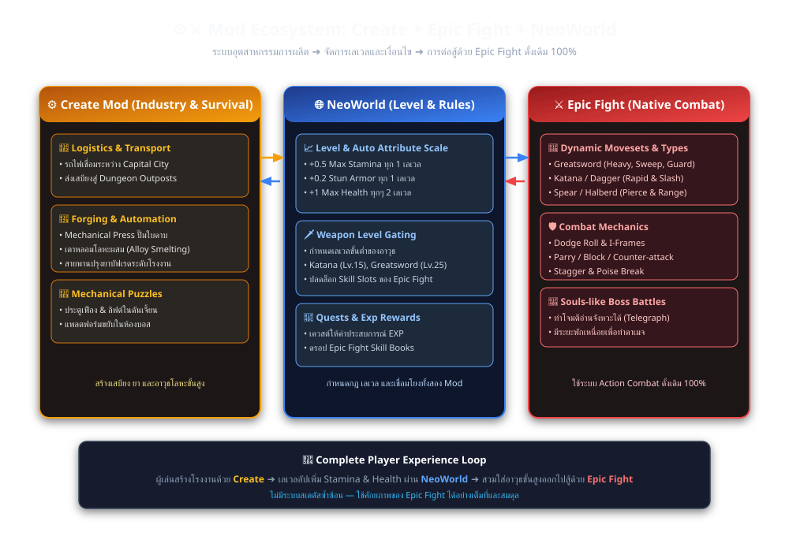
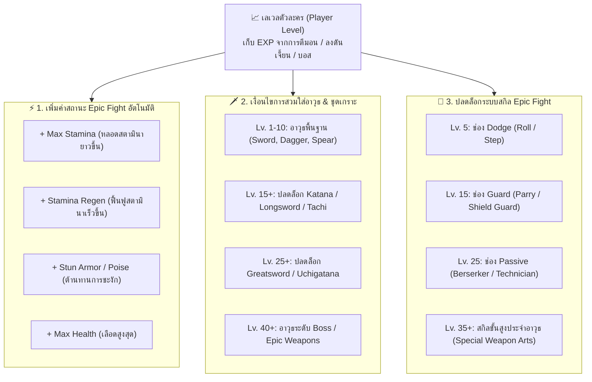
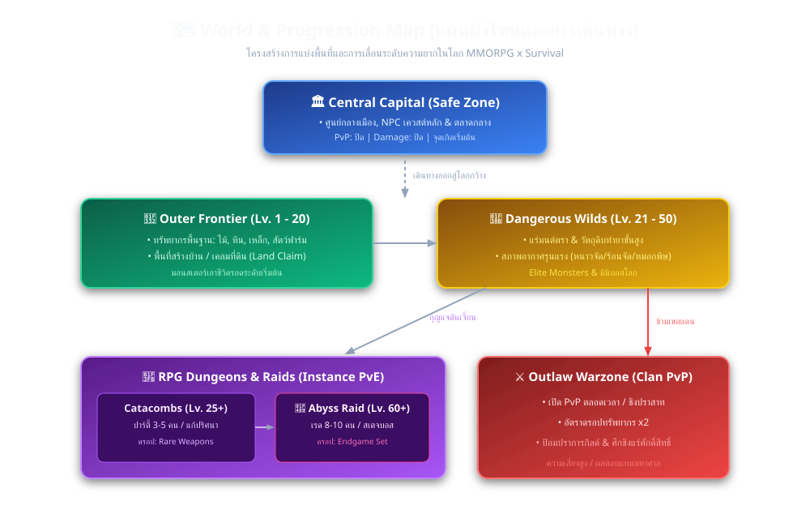
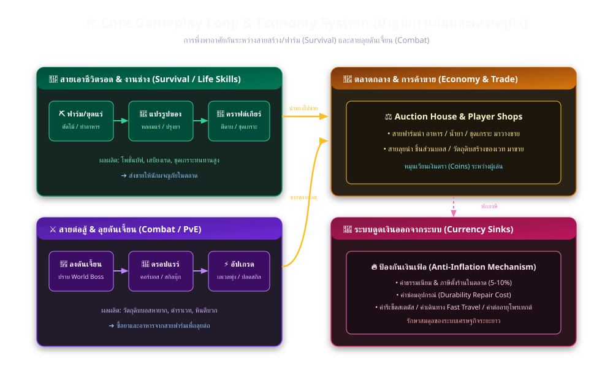
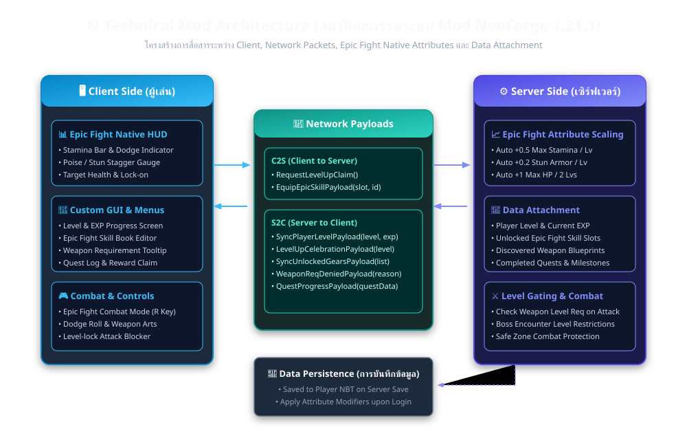
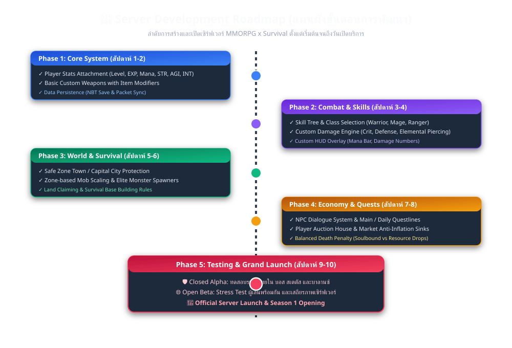

# 🌍 NeoWorld: สถาปัตยกรรมและแผนแม่บท MMORPG ผสมเอาชีวิตรอด

> สถานะปัจจุบัน: เอกสารนี้เป็น แผนแม่บท และ แผนพัฒนา ระบบที่ใช้งานแล้วระบุใน README.md
> โค้ดกำหนดเพดานเลเวลปัจจุบันเป็น 100; ตารางถึง Lv.50 ด้านล่างเป็นแนวคิดการบาลานซ์
> การปรับแอตทริบิวต์ตามระดับ เงื่อนไขปลดล็อกอาวุธ/สกิล และรางวัลจากมอนสเตอร์ยังไม่เปิดใช้งาน

เอกสารสรุปสถาปัตยกรรม แผนผังระบบ และแนวทางการพัฒนาเซิร์ฟเวอร์แนว **MMORPG ผสม เอาชีวิตรอด (เซอร์ไววัล)** สำหรับโปรเจกต์ `NeoWorld` บน **Minecraft NeoForge 1.21.1** ร่วมกับ **Create** และ **Epic Fight** (ใช้ระบบแอตทริบิวต์และสกิล ของ Epic Fight โดยตรง ไม่ทำระบบสเตตัส แยก)

> [!TIP]
> คุณสามารถเปิดดูรูปภาพความละเอียดสูงทั้งหมดและดาวน์โหลดได้สะดวกผ่านไฟล์ [blueprints_viewer.html](diagrams/blueprints_viewer.html)

---

## 1. การทำงานร่วมกันของม็อดหลัก

### ⚙️ Create ม็อด (หัวใจของ การเอาชีวิตรอดและอุตสาหกรรม):
* **โลจิสติกส์และการขนส่ง:** ระบบรถไฟขนส่งมวลชนเชื่อมระหว่างเมืองหลวง (เขตปลอดภัย) ไปยังหมู่บ้านผู้เล่น และเขตหน้าด่านดันเจี้ยน
* **การตีอุปกรณ์ขั้นสูง:** การตีดาบ/ชุดเกราะด้วย Mechanical Press และเตาหลอมโลหะผสม (Alloy Smeltery)
* **โรงงานอัตโนมัติ:** ระบบผลิตน้ำยาขวดใหญ่ อาหารบัฟเรด และกระสุนแบบสายพานโรงงาน
* **กลไกดันเจี้ยน:** ประตูกลเฟือง ลิฟต์ และแท่นเหยียบขยับได้ในห้องเรดบอส

### ⚔️ Epic Fight ม็อด (หัวใจของ การต่อสู้แอ็กชัน RPG ด้วยระบบเดิม 100%):
* **ชุดท่าและแอนิเมชันเฉพาะ:** ท่วงท่าการฟัน แทง ฟาด ตามประเภทอาวุธ (Greatsword, Katana, Spear, Dagger)
* **กลไกไดนามิก:** ระบบกลิ้งหลบ (Dodge Roll) พร้อม I-Frames, การป้องกันและการเคาน์เตอร์ (Parry / Guard), และระบบ Poise / Stagger Break
* **ระบบหนังสือสกิล:** ใช้ระบบสกิลของ Epic Fight (Dodge, Guard, Passive, Mover, Identity Slots)
* **การสู้บอสแนวโซลส์ไลก์:** บอสมีท่วงท่าการโจมตีที่คาดเดาได้ชัดเจน (Telegraphed Attacks) เพิ่มความท้าทาย

### 🌐 NeoWorld ม็อดแกนหลัก (ตัวเชื่อมโยงระบบ):
* **ความก้าวหน้าเลเวลผู้เล่น:** เก็บเลเวลและค่าประสบการณ์ EXP จากการต่อสู้ เควสต์ และดันเจี้ยน
* **ปรับแอตทริบิวต์ Epic Fight ตามเลเวลอัตโนมัติ:** เพิ่มค่าพลังของ Epic Fight และ Vanilla อัตโนมัติเมื่อเลเวลอัป:
  - `epicfight:max_stamina` (+0.5 ต่อเลเวล)
  - `epicfight:stamina_regen` (+0.02 ต่อเลเวล)
  - `epicfight:stun_armor` (+0.2 ต่อเลเวล)
  - `minecraft:generic.max_health` (+1 HP ทุกๆ 2 เลเวล)
* **เงื่อนไขเลเวลใช้อาวุธ:** กำหนดเลเวลขั้นต่ำในการใช้อาวุธและปลดล็อกช่องสกิลของ Epic Fight

---

## 2. ระบบเลเวลและเงื่อนไขการสวมใส่อาวุธ (ความก้าวหน้าเลเวลและเงื่อนไขปลดล็อก)

### ตารางการสเกลค่าพลังตามเลเวล:
| ระดับเลเวล | สตามินาสูงสุด | การฟื้นฟูสตามินา | เกราะต้านชะงัก | พลังชีวิตสูงสุด (HP) | การปลดล็อกอาวุธ & สกิล |
| :---: | :---: | :---: | :---: | :---: | :--- |
| **Lv. 1** | 15.0 | 1.00 | 0.0 | 20 (10 หัวใจ) | อาวุธหิน/ไม้, ดาบสั้น, มีด |
| **Lv. 10** | 20.0 | 1.20 | 2.0 | 25 (12.5 หัวใจ) | หอก, ดาบยาว, ปลดล็อก Dodge Slot |
| **Lv. 20** | 25.0 | 1.40 | 4.0 | 30 (15 หัวใจ) | คาตานะ (Katana), ปลดล็อก Guard/Parry Slot |
| **Lv. 30** | 30.0 | 1.60 | 6.0 | 35 (17.5 หัวใจ) | ดาบใหญ่ (Greatsword), ปลดล็อก Passive Slot |
| **Lv. 50 (ตัวอย่าง)** | 40.0 | 2.00 | 10.0 | 45 (22.5 หัวใจ) | อาวุธบอส ท้ายเกมและวิชาอาวุธ ขั้นสูงสุด |

---

## 3. แผนผังโซนและการเดินทาง

* **เขตปลอดภัย (เมืองหลวงกลาง):** พื้นที่เกิด ศูนย์กลางการค้า ตลาดกลาง และจุดเปลี่ยนอาชีพ (PvP ปิด / Damage ปิด)
* **เขตชายแดน (เลเวล 1 - 20):** พื้นที่สร้างบ้าน โพรเทกต์ที่ดิน รวบรวมไม้ หิน แร่เหล็ก และสัตว์ฟาร์ม
* **ป่าอันตราย (เลเวล 21 - 50):** สภาพอากาศแปรปรวน มอนสเตอร์ระดับสูง ดรอปแร่มนต์ตราและวัตถุดิบปรุงยา
* **ดันเจี้ยนและเรด RPG (เลเวล 25 - 60+):** ดันเจี้ยนแบบ Instance สำหรับปาร์ตี้ 3-10 คน และบอสขนาดใหญ่
* **เขตสงครามแคลน (อาณาเขต PvP):** พื้นที่สงครามกิลด์ ชิงปราสาท และแย่งชิงทรัพยากรคูณ 2

---

## 4. ผังลูปการเล่นและเศรษฐกิจ

* **เอาชีวิตรอดและทักษะดำรงชีพ:** ฟาร์ม ➔ แปรรูปด้วยเครื่องจักร Create ➔ คราฟต์โพชั่น/ชุดเกราะ/อาหารบัฟ นำไปวางขายในตลาดกลาง
* **การต่อสู้และ PvE:** ลงดันเจี้ยน ➔ ดวล Boss ด้วย Epic Fight ➔ ได้รับวัตถุดิบหายาก/สกิลบุ๊ก นำมาแลกเปลี่ยนและซื้อเสบียงจากสายฟาร์ม
* **ช่องทางดูดเงินเพื่อลดเงินเฟ้อ:** เก็บภาษีตลาดกลาง, ค่าซ่อมอุปกรณ์, ค่ารีเซ็ตสเตตัส และค่า การเดินทางด่วน เพื่อรักษาสมดุลเงิน

---

## 5. สถาปัตยกรรมม็อดบน NeoForge 1.21.1

* **ฝั่งไคลเอนต์:** HUD ซ้อนของ Epic Fight เดิม (หลอด Stamina, เกจ Stun), เมนู เลเวลและ EXP, ทูลทิป แจ้งเงื่อนไขเลเวลอาวุธ
* **ชั้นเครือข่าย:** เพย์โหลดกำหนดเอง ซิงค์ Level/EXP และแจ้งเตือนเมื่อใช้อาวุธที่เลเวลไม่ถึง
* **ฝั่งเซิร์ฟเวอร์:** ระบบ แอตแทชเมนต์เลเวล, มอดิไฟเออร์แอตทริบิวต์อัตโนมัติ ซิงค์กับ Epic Fight และ แอตทริบิวต์ Vanilla
* **การบันทึกถาวร:** ซิงค์ข้อมูลลง NBT อัตโนมัติเมื่อเซฟโลกหรือผู้เล่นสลับมิติ

---

## 6. แผนขั้นตอนการพัฒนา

* **ระยะ 1: ระบบหลัก (สัปดาห์ 1-2):** ระบบ แอตแทชเมนต์เลเวลและ EXP, Auto Epic Fight การปรับแอตทริบิวต์ตามระดับ, เงื่อนไขเลเวลใช้อาวุธ
* **ระยะ 2: การต่อสู้และสกิล (สัปดาห์ 3-4):** ปรับจูนแอนิเมชันอาวุธ Epic Fight, ดรอปหนังสือสกิล, UI เลเวลเฉพาะ
* **ระยะ 3: โลกและการเอาชีวิตรอด (สัปดาห์ 5-6):** ป้องกันเมือง, ระบบ โพรเทกต์ที่ดิน, โรงงาน Create สำหรับคราฟต์ไอเทม
* **ระยะ 4: เศรษฐกิจและเควสต์ (สัปดาห์ 7-8):** ระบบเควสต์ NPC, ตลาดผู้เล่น, ระบบหักภาษีและ บทลงโทษเมื่อตาย
* **ระยะ 5: เปิดจริง (สัปดาห์ 9-10):** อัลฟาแบบปิด ➔ เบตาแบบเปิด ➔ เปิดให้บริการอย่างเป็นทางการ
